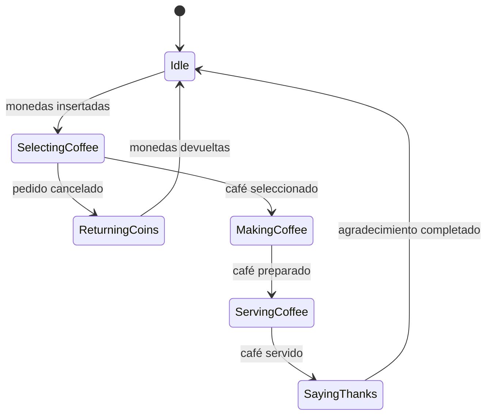

## Diagrama de estados

## Estados

- **Idle:** La máquina está en reposo.
- **SelectingCoffee:** Hay monedas insertadas y se puede seleccionar un café o cancelar el pedido.
- **ReturningCoins:** La máquina devuelve las monedas de un pedido cancelado.
- **MakingCoffee:** La máquina prepara el tipo de café seleccionado.
- **ServingCoffee:** El café está listo para recoger.
- **SayingThanks:** La máquina agradece al usuario antes de volver al reposo.
- **Error:** Estado para indicar una operación no válida, como introducir una cantidad de monedas no positiva.

## Cafés disponibles

Al ejecutar el programa, elige una opción:

1. Capuccino
2. Americano
3. Con chocolate

La selección se mantiene durante la preparación y se muestra al servir el café. Si se introduce una opción distinta de `1`, `2` o `3`, el programa vuelve a solicitarla.

## Transiciones principales

- **Idle → SelectingCoffee:** se insertan monedas válidas.
- **SelectingCoffee → ReturningCoins → Idle:** se cancela el pedido y se completa la devolución de monedas.
- **SelectingCoffee → MakingCoffee → ServingCoffee:** se elige uno de los tres cafés y se prepara.
- **ServingCoffee → SayingThanks → Idle:** se sirve el café, se muestra el agradecimiento y la máquina queda lista para otro pedido.
